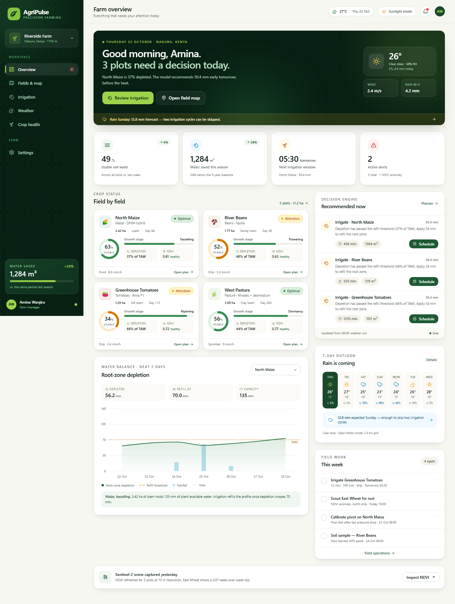

# AgriPulse

**Smart precision farming & automated irrigation decision platform** — a working MVP of the AgriPulse proposal, built with Next.js, TypeScript, Tailwind CSS, Leaflet and Recharts.

The app turns weather, soil and satellite data into one clear daily answer per field: **irrigate now, delay for rain, or hold**. Everything runs on a bundled demo farm; no API keys or database are required.



## Quick start

Requires Node.js 20+.

```bash
npm install
npm run dev
```

Open <http://localhost:3000>.

```bash
npm run build      # production build
npm run start      # serve the production build
npm run typecheck  # TypeScript only
```

> The demo date is fixed at **22 October 2026** so server and client render identically. The five plots total **11.21 ha** on a 61.4 ha farm boundary near Nakuru, Kenya.

## What is implemented

| Area | MVP behaviour |
| --- | --- |
| **Farm overview** | Weather-led morning brief, 4 KPIs, field status cards, 7-day irrigation queue, water-balance chart, forecast strip, task list |
| **Fields & map** | Leaflet + OpenStreetMap, farm boundary, 5 sample plots, status/moisture/NDVI fill modes, geodesic area labels, click-to-inspect popups |
| **Draw a plot** | Click corners on the map, live area readout, undo/cancel/Esc, save modal (crop, variety, soil, planting date, system, application rate), persisted locally |
| **Irrigation studio** | FAO-56 ET₀, crop coefficients, Ks stress factor, daily depletion balance, per-plot recommendation, runtime/volume/energy calculator, scheduling queue |
| **Weather** | Current conditions, hourly ET curve, 7-day temperature + rainfall chart, warnings, field-work windows, day-by-day implications |
| **Crop health** | Sentinel-style NDVI heatmap with low-vigour patch, 8-week NDVI trend, soil lab results vs. target ranges, pH/EC, phenology timeline, agronomy actions |
| **Settings** | Farm profile, irrigation defaults, integrations, notification channels, sunlight mode, demo reset |
| **Field-first UX** | High-contrast "sunlight mode", 44 px+ touch targets, mobile bottom nav, responsive layouts, accessible focus states, reduced-motion support |
| **PWA** | Manifest, maskable icons and a production service worker for an offline app shell |

## The science

`lib/et.ts` implements the FAO-56 Penman–Monteith reference evapotranspiration:

```
ET₀ = [0.408 Δ (Rn − G) + γ (900/(T+273)) u₂ (eₛ − eₐ)] / [Δ + γ (1 + 0.34 u₂)]
```

It includes extraterrestrial radiation from latitude and day-of-year, net short/long-wave radiation, saturation vapour pressure and the psychrometric constant at the farm's elevation.

The root-zone water balance follows FAO-56 Chapter 8:

```
TAW = (θFC − θWP) × Zr
RAW = p × TAW
Ks  = (TAW − Dr) / (TAW − RAW)        when Dr > RAW
ETc = ET₀ × Kc × Ks
Dr,i = Dr,i−1 − Pe − I + ETc
```

Recommendations are derived from depletion vs. RAW:

- **Irrigate** when depletion crosses the refill threshold; depth refills the root zone, gross depth accounts for application efficiency.
- **Delay** when ≥ 10 mm of rain is forecast in the next 48 h and the crop is not yet severely stressed.
- **Hold** when usable water is comfortably above the trigger.

Runtime and volume depend on the plot's configured application rate (mm/h), efficiency and area. Pump energy assumes a 12 m total head and 55% pump efficiency.

Crop presets (maize, beans, tomato, pasture, wheat, potato) live in `lib/crops.ts` with stage lengths, Kc, NDVI expectations, root depth and depletion fraction. Soil water constants by texture are in the same file.

## Tech stack

- **Next.js 15** App Router, React 19, TypeScript
- **Tailwind CSS 3** with a custom canopy/lime/sand palette
- **Leaflet 1.9** for the interactive map (loaded client-side, no API key)
- **Recharts 2** for water-balance, forecast and NDVI charts
- **lucide-react** icons
- **React context + localStorage** for plot and schedule state in the MVP
- **PostgreSQL + PostGIS** schema ready in `db/schema.sql` for the production backend

## Project structure

```
app/                    App Router pages
  page.tsx              Farm overview
  fields/page.tsx       Map, drawing and plot registry
  irrigation/page.tsx   ET₀ + water balance planner
  weather/page.tsx      Forecast and warnings
  health/page.tsx       NDVI and soil analytics
  settings/page.tsx     Farm profile and integrations
components/             UI, charts, map, dashboard panels
lib/
  et.ts                 FAO-56 engine and recommendations
  crops.ts              Crop, Kc and soil-water profiles
  data.ts               Demo farm, weather and alerts
  geo.ts                Geodesic area / centroid helpers
  types.ts              Shared domain types
providers/              Farm state, persistence and toasts
db/schema.sql           PostGIS schema + row-level security
public/                 Manifest, icons, service worker
```

## Demo data

- **Farm:** Riverside Farm, Nakuru, Kenya · 1,750 m · 61.4 ha boundary
- **Plots:** North Maize (2.42 ha), River Beans (1.77 ha), Greenhouse Tomatoes (1.29 ha), West Pasture (3.69 ha), East Wheat (2.04 ha)
- **Weather:** 7 days from 22 Oct 2026, including a 12.8 mm rain event on Sunday
- **Satellite:** synthetic NDVI surface at 10 m, deterministic per plot for stable rendering

Plots you draw, task check-offs and scheduled irrigation are stored in `localStorage` under `agripulse.state.v1`. Use **Settings → Reset demo data** to restore the original farm.

## Production path

The MVP is intentionally front-end complete and backend light. To take it to production:

1. **Database & auth** — apply `db/schema.sql` to Supabase/Postgres with PostGIS; replace the context store with server actions or React Query.
2. **Weather** — poll Open-Meteo (hourly + 7-day) per farm centroid, cache responses, store daily ET₀ in `weather_days`.
3. **Satellite** — request Sentinel-2 L2A NDVI tiles from Sentinel Hub; store scene metadata and render tiles or a raster overlay.
4. **Sensors** — ingest LoRa soil probes via MQTT/HTTP, reconcile with the modelled water balance (Kalman-style update or simple bias correction).
5. **Notifications** — scheduled jobs evaluate the engine each morning and push WhatsApp/SMS/email via a queue.
6. **PWA & offline** — queue plot edits and irrigation logs in IndexedDB and sync when connectivity returns.
7. **Validation** — field trials to calibrate Kc, soil water constants and the recommendation thresholds per agro-ecological zone.

Environment variables for live integrations are listed in `.env.example`. Set `NEXT_PUBLIC_SITE_URL` to the deployed origin so canonical URLs, `robots.txt` and `sitemap.xml` point at the right host.

## Notes & limitations

- Demo data only: no live weather/satellite calls and no server persistence.
- The map loads OpenStreetMap tiles from the network; polygons still render on a plain background when offline.
- The service worker registers in production builds only.
- The name "AgriPulse" and the sample farm are illustrative.
